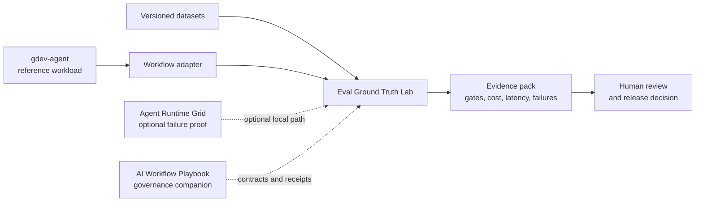

# Artem Shishkin

**AI Systems Engineer focused on evaluation, reliability, and governed execution
for LLM workflows.**

I build AI backend systems where model and harness changes are evaluated, risky
actions are controlled or reviewed, and cost, latency, and failure behavior remain
observable.

Incoming MS in Financial Technology and Analytics at UT Dallas, Fall 2026.

**Start here:** [Eval Ground Truth Lab](https://github.com/ashishki/Eval-Ground-Truth-Lab) ·
[5-minute reviewer path](https://github.com/ashishki/Eval-Ground-Truth-Lab#5-minute-reviewer-path) ·
[evidence index](https://github.com/ashishki/Eval-Ground-Truth-Lab/blob/main/docs/EVIDENCE_INDEX.md) ·
[known limits](https://github.com/ashishki/Eval-Ground-Truth-Lab/blob/main/docs/KNOWN_LIMITS.md)

## Flagship: regression evaluation for LLM workflows

[Eval Ground Truth Lab](https://github.com/ashishki/Eval-Ground-Truth-Lab) helps an
AI engineer decide whether a model, prompt, tool, policy, or harness change is safe
to release. It runs versioned datasets against baseline and candidate systems,
applies deterministic quality, cost, and latency gates, and produces reviewable
reports for CI and human approval.

> **Current maturity:** local research prototype. Public evidence uses versioned
> synthetic or curated datasets and reproducible local runs. It does not establish
> production traffic, customer adoption, or a production SLO.

## System map

The gdev-to-Eval path has a reproduced local same-image run with a published
content-addressed failure report. Dashed edges are optional relationships, not
claims that a production platform, customer deployment, or production SLO exists.

## Selected systems

| System | Role | Best evidence | Maturity |
|---|---|---|---|
| [Eval Ground Truth Lab](https://github.com/ashishki/Eval-Ground-Truth-Lab) | Regression evaluation and release gates | [Evidence index](https://github.com/ashishki/Eval-Ground-Truth-Lab/blob/main/docs/EVIDENCE_INDEX.md) | Local; synthetic or curated datasets |
| [Agent Runtime Grid](https://github.com/ashishki/Agent-Runtime-Grid) | Queue-backed execution with PostgreSQL lifecycle state, Redis Streams delivery, bounded retries, artifacts, and failure injection | [Evidence index](https://github.com/ashishki/Agent-Runtime-Grid/blob/main/docs/EVIDENCE_INDEX.md) | Local reliability experiments |
| [gdev-agent](https://github.com/ashishki/gdev-agent) | Governed support-workflow reference workload with approval, audit, cost controls, and PostgreSQL RLS | [Canonical Eval result](https://github.com/ashishki/Eval-Ground-Truth-Lab/blob/main/docs/EVIDENCE_INDEX.md) | Local reference workload; canonical quality gate currently fails |
| [AI Workflow Playbook](https://github.com/ashishki/AI_workflow_playbook) | Independent governance and verification companion | [Guarantee maturity](https://github.com/ashishki/AI_workflow_playbook#guarantee-maturity) | Mechanisms tested; adoption impact unproven |

## Engineering evidence

- Versioned datasets and deterministic validators for reproducible regression
  gates.
- Baseline/candidate comparison with explicit quality, cost, and latency
  thresholds.
- PostgreSQL-authoritative job lifecycle state with Redis Streams delivery,
  bounded retries, cancellation, timeouts, and artifact integrity checks.
- Human review and evidence indexes that separate local demonstrations, planned
  work, and external validation.
- PostgreSQL owner/application-role separation with FORCE RLS and a clean-Compose
  cross-tenant denial proof for the reference workload.

## Applied work

- [Trader Risk Audit](https://github.com/ashishki/entropy_protocol/tree/master/products/trader-risk-audit)
  applies deterministic post-trade policy checks to local or public-data examples.
  It is a case study, not a live trading system or financial advice.
- [Telegram Research Agent](https://github.com/ashishki/telegram-research-agent)
  is a single-user research pipeline for source provenance, temporal threads,
  feedback, and bounded read-only assistance.

## Current focus

- Publish the verified one-command reviewer umbrella after its remote repository
  and release surface are available.
- Complete the history-preserving Trader Risk Audit extraction without publishing
  source data whose redistribution rights are unclear.
- Validate one independently owned workflow adapter and structured external
  feedback without inventing users, outcomes, or adoption evidence.

## Background

Before AI engineering, I worked as an international technical educator for
Schwarzkopf Professional. I bring that training discipline to design reviews,
technical writing, and cross-functional communication without treating it as a
substitute for engineering evidence.

I begin the MS in Financial Technology and Analytics at UT Dallas in Fall 2026,
with a growing focus on reliable AI systems for financial and document workflows.

## Contact

[LinkedIn](https://www.linkedin.com/in/ashishki/) ·
[GitHub](https://github.com/ashishki)
