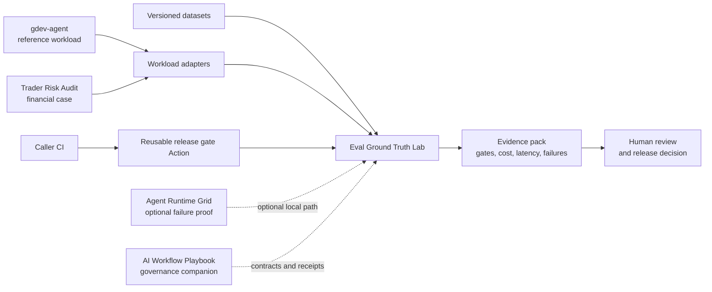

# Artem Shishkin

**AI Systems Engineer focused on evaluation, reliability, and governed execution
for LLM workflows.**

I build AI backend systems where model and harness changes are evaluated, risky
actions are controlled or reviewed, and cost, latency, and failure behavior remain
observable.

Incoming MS in Financial Technology and Analytics at UT Dallas, Fall 2026.

**Start here:** [Eval Ground Truth Lab](https://github.com/ashishki/Eval-Ground-Truth-Lab) ·
[runnable reviewer demo](https://github.com/ashishki/ai-workflow-reliability-lab) ·
[v0.2.1 evidence](https://github.com/ashishki/Eval-Ground-Truth-Lab/tree/v0.2.1/docs/evidence/releases/v0.2.1) ·
[known limits](https://github.com/ashishki/Eval-Ground-Truth-Lab/blob/main/docs/KNOWN_LIMITS.md)

## Flagship: regression evaluation for LLM workflows

[Eval Ground Truth Lab](https://github.com/ashishki/Eval-Ground-Truth-Lab) helps an
AI engineer decide whether a model, prompt, tool, policy, or harness change is safe
to release. It runs versioned datasets against baseline and candidate systems,
applies deterministic quality, cost, and latency gates, and produces reviewable
reports for CI and human approval.

> **Current maturity:** released open-source alpha (`v0.2.1`) with local,
> synthetic, or curated evidence. v0.2.1 is an internal correctness/security
> release, not external-feedback maintenance evidence. It does not establish
> production traffic, customer adoption, or a production SLO.

## System map

The published
[reviewer umbrella](https://github.com/ashishki/ai-workflow-reliability-lab)
provides the clean-checkout path across the locked Eval, gdev, and optional
Runtime components. The gdev and sanitized Trader-to-Eval paths are reproduced
local integrations; the reusable Action has a synthetic CI wiring proof. Dashed
edges are optional relationships, not claims that a production platform,
customer deployment, or production SLO exists.

## Selected systems

| System | Role | Best evidence | Maturity |
|---|---|---|---|
| [Eval Ground Truth Lab](https://github.com/ashishki/Eval-Ground-Truth-Lab) | Regression evaluation and reusable CI release gates | [v0.2.1 exact-gate evidence](https://github.com/ashishki/Eval-Ground-Truth-Lab/tree/v0.2.1/docs/evidence/releases/v0.2.1) | Released alpha; local, synthetic, or curated evidence |
| [Agent Runtime Grid](https://github.com/ashishki/Agent-Runtime-Grid) | Queue-backed execution with PostgreSQL lifecycle state, Redis Streams delivery, bounded retries, artifacts, and failure injection | [Evidence index](https://github.com/ashishki/Agent-Runtime-Grid/blob/main/docs/EVIDENCE_INDEX.md) | Local reliability experiments |
| [gdev-agent](https://github.com/ashishki/gdev-agent) | Governed support-workflow reference workload with approval, audit, cost controls, and PostgreSQL RLS | [Canonical Eval result](https://github.com/ashishki/Eval-Ground-Truth-Lab/blob/main/docs/EVIDENCE_INDEX.md) | Local reference workload; canonical quality gate currently fails |
| [AI Workflow Playbook](https://github.com/ashishki/AI_workflow_playbook) | Independent governance and verification companion | [Guarantee maturity](https://github.com/ashishki/AI_workflow_playbook#guarantee-maturity) | Mechanisms tested; adoption impact unproven |

## Engineering evidence

- Versioned datasets and deterministic validators for reproducible regression
  gates.
- Baseline/candidate comparison with explicit quality, cost, and latency
  thresholds, plus a least-privilege
  [reusable Action v0.1.0](https://github.com/ashishki/Eval-Ground-Truth-Lab/blob/action-v0.1.0/docs/GITHUB_ACTION.md).
- PostgreSQL-authoritative job lifecycle state with Redis Streams delivery,
  bounded retries, cancellation, timeouts, and artifact integrity checks.
- Human review and evidence indexes that separate local demonstrations, planned
  work, and external validation.
- PostgreSQL owner/application-role separation with FORCE RLS and a clean-Compose
  cross-tenant denial proof for the reference workload.
- A published
  [one-command reviewer umbrella](https://github.com/ashishki/ai-workflow-reliability-lab)
  with exact component locks, tamper-checked evidence, readable previews, and an
  explicit pending-human-decision boundary.

## Applied work

- [Trader Risk Audit](https://github.com/ashishki/entropy_protocol/tree/master/products/trader-risk-audit)
  applies deterministic post-trade policy checks to local or public-data examples.
  A history-preserving, path-purged standalone v0.2 candidate is verified locally,
  and Eval consumes its sanitized evidence through a documented
  [adapter contract](https://github.com/ashishki/Eval-Ground-Truth-Lab/blob/main/docs/TRADER_RISK_AUDIT_ADAPTER.md).
  The separate remote repository is not yet published. This is a case study, not
  a live trading system or financial advice.
- [Telegram Research Agent](https://github.com/ashishki/telegram-research-agent)
  is a single-user research pipeline for source provenance, temporal threads,
  feedback, and bounded read-only assistance.

## Current focus

- Publish the verified standalone Trader v0.2 candidate when repository-creation
  access is available.
- Validate one independently owned workflow adapter and collect two consented,
  structured feedback records.
- Record one real independent umbrella review, then turn attributable external
  feedback into a bounded maintenance release and regression test.

## Background

Before AI engineering, I worked as an international technical educator for
Schwarzkopf Professional. I bring that training discipline to design reviews,
technical writing, and cross-functional communication without treating it as a
substitute for engineering evidence.

I begin the MS in Financial Technology and Analytics at UT Dallas in Fall 2026,
with a growing focus on reliable AI systems for financial and document workflows.

## Contact

[LinkedIn](https://www.linkedin.com/in/ashishki/) ·
[GitHub](https://github.com/ashishki)
